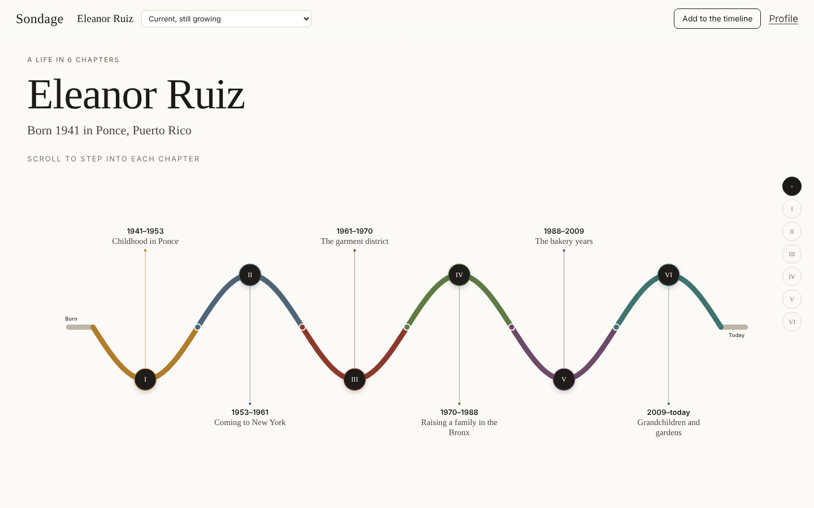

# Sondage — proof of concept

An interview between a Senior Fellow and a historian, recorded on the Fellow's own
computer exactly as it sounded, sealed so it can never be changed without detection,
and encrypted so that only the Fellow can open it. Around it, a life timeline that
grows through intake, the 10x10 session, and after delivery.



## What's here

| Folder | What it is |
| --- | --- |
| `web/` | Rails 8 web app: roles, intake form builder, 10x10 lists, the scroll-in timeline (photos, songs, articles, letters, places, events), timeline versions, scheduling, the historian's interview room, the desktop app's API, and call signaling over Action Cable. |
| `desktop/` | Electron app for the Fellow, written for someone who finds technology hard: one step per screen, very large text. Safety-copy setup, getting recordings back on a new computer, a headphone and microphone check, the interview, saving (sealing), listening, and the `sondage-verify` command. |
| `shared/` | Code used by both the desktop app and the historian's browser: the raw recorder, hash chain, chunk transfer and the call. `scripts/sync-shared.sh` copies it into both apps. |
| `e2e/` | An end-to-end test: the real Electron app (as the Fellow) and Chrome (as the historian) hold a full interview with synthetic microphones against a stand-in for the Rails app, then seal and verify the capsule. |
| `docs/screenshots/` | Screens captured from those test runs. |

## What was tested, and what wasn't

- **Sealing, encryption and verification** (`desktop/test`): 6 automated tests, all passing. They cover recording, signing, sealing, opening only with the Fellow's key, detecting a single changed audio sample, detecting an edited manifest, refusing a forged historian signature, out-of-order and replaced chunks, recovery shares, and chunk transfer surviving a dropped connection.
- **The whole journey, end to end** (`e2e/`): passing. A Fellow sets up safety copies, joins a video interview that the historian starts and stops, and the recording is saved, checked and played back in the app. Then the computer is "lost": a second, empty copy of the app gets the key back when the Fellow and Sondage approve, and opens the same recording.
- **The interview itself:** passing for audio and for video interviews. The Electron app and the historian's page in Chrome connect peer to peer and record raw 32-bit float audio on both sides; the historian's chunks travel straight to the Fellow's app. The historian's browser checks the manifest byte for byte before co-signing, then the capsule is sealed, encrypted, and verified both from the app and from the command line.
- **The Rails app was not booted.** The sandbox it was built in couldn't reach rubygems.org, so `bundle install` was impossible. Every Ruby and ERB file passes a syntax check, and its JavaScript and CSS (timeline, historian room) were exercised by the end-to-end test through a stand-in server. The Rails tests in `web/test` (including sign-in, receipts, the call channel and the safety-copy flow) are written but haven't been run. **Run `bin/setup` and `bin/rails test` first, and expect some small fixes.**
- **Trusted timestamps** weren't reachable from the sandbox. The request format was validated with OpenSSL, and the app seals without certification (and says so) when the service is down.

## Running it

Requirements: Ruby 3.3+, Node 20+, and headphones.

```bash
# 1. The web app (with demo data)
cd web
bin/setup            # bundle install, create the database, load demo data
bin/rails server     # http://localhost:3000

# 2. The desktop app (the Fellow)
cd desktop
npm install
npm start            # signs in to http://localhost:3000 by default
```

Sign-in uses [Devise](https://github.com/heartcombo/devise): "Forgot your password?" emails a reset link, and an account locks for an hour after 10 wrong passwords. In development, emails open in your browser instead of being sent (letter_opener).

If you already ran `bin/setup` with an earlier version, run `bin/rails db:migrate` to upgrade the database in place.

Demo accounts (password `sondage-demo-2026` for all three):

| Who | Email | Starts at |
| --- | --- | --- |
| Admin | `admin@sondage.test` | All Fellows, intake builder, scheduling |
| Historian | `historian@sondage.test` | Their interviews, questions, interview room |
| Fellow (Eleanor Ruiz, fictional) | `eleanor@sondage.test` | Her timeline, intake, 10x10. Signs in to the desktop app too. |

To hold a test interview on one machine:
1. Sign in as the historian in a browser and open the interview room.
2. Sign in to the desktop app as Eleanor. The first time, it walks her through her safety copies.
3. Click **Start my interview**. The historian then clicks **Start recording**, and later **End interview and save**.

The demo interview is a video interview. An admin can switch any interview between video and audio on its page.
Demo photographs are abstract stand-ins stamped DEMO; songs are real recordings, cited
rather than copied; clippings are labelled as demo.

The end-to-end test (needs Chrome; on Linux run it under `xvfb-run`):

```bash
cd desktop && npm install && cd ../e2e && npm install
node server.mjs &            # stand-in for the Rails app on :3999
node e2e-call.mjs            # full interview; screenshots in e2e/out/
```

## How the guarantees work

**Unadulterated.** The live call is only for talking. Each person's microphone is
recorded separately on their own device, with echo cancellation, noise suppression,
automatic gain and voice isolation all switched off, as 32-bit float samples at the
device's own rate (no resampling), in 10-second chunks. The device check shows the
Fellow what their computer is doing to their voice and won't continue while any
processing is on. Video, when chosen, is recorded locally too; it has to be compressed,
so the manifest labels it as such and the WAV audio stays the master record.

**Unchanged.** Every chunk is hashed the moment it's written, and each hash commits to
the one before it, so a missing, reordered or altered chunk breaks the chain. At the
end, the manifest describes every byte. The historian's browser checks its own tracks
against what it recorded before signing, and then both people sign it (Ed25519).
An independent RFC 3161 authority timestamps its fingerprint; only the hash leaves the
computer. The package is an OCFL 1.1 object with SHA-512 fixity.

**Theirs alone.** The Fellow's keys are created on their computer, kept in the
operating system's keychain, and never seen by them. The capsule is encrypted with
[age](https://age-encryption.org) to the Fellow's key. The historian's recording
reaches the Fellow's computer over the call's encrypted data channel, never through a
server, and the historian's browser discards its copy after sealing. The web app
receives only a public receipt: fingerprints, signatures and the timestamp.

**Never lost: four safety copies.** At setup the key is split (Shamir, 2 of 4) into four
safety copies: one for the Fellow, one each for two people they trust, and one for
Sondage. Any two rebuild the key; one alone reveals nothing.
- The Fellow's and family's copies go out as emails **from the Fellow's own email app**, so they never pass through Sondage. Sondage stores its own copy (encrypted at rest) and only a fingerprint of the others.
- On a new computer, the Fellow clicks **Send the emails**. Each holder gets a short email and clicks the button in their safety email. Their copy travels only in the part of the link after `#`, which browsers never send to a server. It is encrypted in their browser to a one-time key made by the new computer, so the copies only ever come together there.
- Sondage releases its own copy only after an admin phones the Fellow, and after a waiting period (`RECOVERY_WAIT_HOURS`, 72 hours in production). The family is emailed straight away and can stop a request that isn't the Fellow.
- The restored key is checked against the one registered for the account.

**Human-made.** No AI anywhere in collection, recording, transcription or
interpretation. Every capsule carries an empty Generative Information Package folder
saying so, and the manifest declares it. Context added to the timeline (a headline, a
song from that summer) is always labelled as context, with who added it.

### Inside a capsule (once opened)

```
0=ocfl_object_1.1
inventory.json (+ .sha512)          SHA-512 of every file
v1/content/
  manifest.json                     every file, its SHA-256, every chunk's hash and chain link,
                                    devices, processing settings, participants, provenance log
  signatures.json                   Fellow and historian, Ed25519 over manifest.json
  timestamp.tsr                     RFC 3161 token (when the service was reachable)
  audio/fellow-audio.wav            32-bit float, one channel
  audio/historian-audio.wav
  video/*.webm                      video sessions only, labelled compressed
  timeline/timeline-at-interview.json   context, not part of the encounter
  gip/README.txt                    Generative Information Package (empty)
  VERIFY.txt                        how to check it without any Sondage software
```

Check one from `desktop/`: `npm run verify -- <file>.capsule.age --identity <key file> [--extract <folder>]`,
or follow `VERIFY.txt` by hand.

## Before this goes in front of a Fellow

- **Boot and test the Rails app.** See above.
- **TURN server.** Without one (coturn, via `TURN_URL`, `TURN_USERNAME`, `TURN_PASSWORD`), calls between some home networks won't connect.
- **Signed installers** with Apple notarization and a Windows certificate (for example with electron-builder). Then point `DESKTOP_*_URL` at them for the download page.
- **The historian's browser keeps unsent chunks in memory.** A crash or reload before they reach the Fellow loses them. Storing them in the browser's private file storage (OPFS) is the next step.
- **Timestamp authority:** choose one for production and record its CA certificate alongside the verifier.
- **Safety copies:** replacing a helper later needs a new key for future recordings (older recordings keep the old one). Sondage should confirm that holding one of four copies fits "Sondage retains no keys".
- **The Fellow's web pages** (intake questions, 10x10 lists, adding to the timeline) have bigger text and plainer words on the home page, but deserve the same one-step-per-screen redesign as the desktop app.
- **Video files** from the browser recorder lack a duration header; most players cope, but archival copies should be remuxed (without re-encoding) at sealing.
- **Linux without a keychain** falls back to a file readable only by the user. The app says so.
- **Identity verification** at onboarding, human transcription as a later version beside the sealed originals, and encrypted upload to storage the Fellow chooses are designed but not built.
- **Questions for Sondage:** whether an encrypted cloud copy nobody else can read satisfies Non-Custodial Sovereignty, and whether compressed video is acceptable alongside the uncompressed audio.
